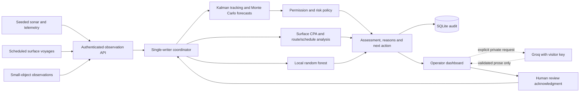

# Harbor-maester

**From harbor observations to explainable recommendations.** Harbor-maester is a CPU-first decision-support research prototype built by **The Argonauts**. It connects scheduled vessel traffic, synthetic sonar and telemetry, a numerical decision engine, and a live operator dashboard. Operators can inspect what needs attention, the evidence behind it, and the next action to consider.

The demonstration covers eight Long Beach harbor areas. It supports routine traffic awareness, restricted-zone approaches, route deviations, missing observations, and small-object movement classification. All observations and policy zones in the demonstration are synthetic or illustrative. Recommendations are advisory: acknowledgment records human review and does not control a vessel or dispatch responders.

## Start the complete application

### Docker — the same entry point used by Hugging Face Spaces

```sh
docker build -t harbor-maester .
docker run --rm --name harbor-maester -p 127.0.0.1:7860:7860 harbor-maester
```

Open **http://localhost:7860**. No API key is needed for the simulation, tracking, forecasts, policy assessments or movement classifier. The dashboard starts a harbor-wide exercise when no active session exists. Use **Simulation** for scenarios and **Contacts** for explanations and review.

For optional language-model explanations, expand **Your Groq API key** in the sidebar, enter your own key and select **Use my key**. In **Contacts → Optional AI explanation**, select **Request AI explanation**. Saving a key, page refreshes and simulation updates make no AI calls. The key and private explanation remain in that browser session's server memory; they are not stored in the shared database or shown to other visitors. Remove the key when finished. Selected synthetic evidence is sent to Groq only on request, using your account's quota.

### Local Python development

Use Python **3.13** for parity with the release container. From the repository root in PowerShell:

```powershell
python -m venv .venv
.\.venv\Scripts\python.exe -m pip install -r requirements-space-lock.txt
.\.venv\Scripts\python.exe -m pip install --no-deps --no-build-isolation -e .
.\.venv\Scripts\python.exe -m scripts.launch_demo
```

Open **http://127.0.0.1:8501**. On Linux/macOS, use `python3` to create the environment and `.venv/bin/python` thereafter. The launcher creates missing local engine tokens without displaying them. Ctrl+C stops both services. Local SQLite data is retained under `runtime/`.

The local launcher also supports `--ai fake` for a visibly labeled mock or `--ai groq` for a private, operator-owned installation configured through `.env`. **The public Spaces launcher always disables instance-wide Groq credentials**; visitors supply their own key. See [deployment and release instructions](docs/DEPLOYMENT.md).

## System architecture



| Component | Method | Output |
|---|---|---|
| Track estimation | Four-state constant-velocity Kalman filter; Mahalanobis innovation gating; Joseph covariance update | Position, velocity, uncertainty and evidence quality |
| Conditional forecasting | Mean propagation and 32 Monte Carlo paths over a 30-second horizon | Estimated zone-entry times and uncalibrated sampled hit fractions |
| Decision policy | Explicit mission permissions, freshness gates, route hysteresis, reason/action rules and incident lifecycle | Risk band, evidence references, recommendation and review request |
| Surface analysis | Closest point of approach, cross-track distance and schedule delay | Encounter, off-route and delay advisories |
| Small-object analysis | 48-tree random forest over seven motion features; abstention on poor or ambiguous evidence | Movement category, model scores and unconfirmed candidate object types |
| Optional explanation | Retrieved demo procedures and schema/reference-validated LLM output | Evidence-based narrative; never an authorization or control decision |

The forest is the locally trained ML model. Kalman tracking, geometric forecasting and policy are numerical/analytical methods. Groq hosts the optional language model. There is no learned end-to-end threat classifier and no local LLM requirement. See [architecture and mathematical methods](docs/ARCHITECTURE.md) and the [model and data card](docs/MODEL_CARD.md).

## Operator workflow

1. **Overview:** inspect the priority contact, harbor atlas, moving traffic and attention queue.
2. **Contacts:** inspect evidence, permission, forecast and suggested next step; acknowledge review or explicitly request an AI explanation.
3. **Traffic:** review scheduled voyages, encounter advisories and route/schedule deviations.
4. **Simulation:** select a location, traffic density, playback pace and incident scenario; pause, step or exercise failures.
5. **Activity:** inspect observation delivery, core health and committed audit history.
6. **Detection:** review object movement and possible interpretations after at least 16 observations spanning 30 scenario seconds.

The public instance is **one shared exercise**: scenario and playback controls affect all viewers. Keys and personal AI explanations are isolated by browser session. This is a collaborative demonstration, not an authenticated multi-tenant operations service. Refreshing a browser may reset its private key state. See [security and hosting boundaries](docs/SECURITY.md).

## Evidence and evaluation

| Recorded experiment | Result | Interpretation |
|---|---|---|
| Seeded restricted-area approach | High concern at 36 s; estimated entry at 51 s | 15-second conditional warning lead in one synthetic case |
| Synthetic sonar outage | Stale at 13 s; lost at 20 s after last report at 9 s | Explicit degradation of evidence quality |
| Motion classification | 96.5% accuracy on 800 held-out synthetic trajectories | Behavior classification within the generator's distribution |
| Motion abstention | 97% hypothesis coverage | Confidence/margin and feature-envelope checks withhold some outputs |

Results are recorded in [harbor evaluation](docs/harbor-evaluation.json) and [motion evaluation](docs/motion-evaluation.json). They do not establish real-world debris recognition, collision prevention, lives saved or response-time reduction. Field data, independent validation and responder studies remain future work.

To run the tests:

```powershell
.\.venv\Scripts\python.exe -m pip install -r requirements-lock.txt
.\.venv\Scripts\python.exe -m pytest tests simulator/tests -q
.\.venv\Scripts\python.exe project-website/check_site.py
```

Tests include API authentication, transactional persistence, tracking, forecasts, sensor failure, stale AI rejection, explicit-request-only inference, private-key isolation, traffic schedules, motion abstention and dashboard interactions. [Release validation](docs/RELEASE_VALIDATION.md) records what was actually exercised for this release.

## Repository guide

| Path | Responsibility |
|---|---|
| `src/harbor_engine/` | Authoritative engine, API, numerical models, policy, persistence and AI validation |
| `harbor_simulation/` | Operator dashboard, API bridge, scheduled traffic and object generators |
| `simulator/` | Original Pako simulator and reusable sonar/telemetry sensors |
| `config/demo_policy.yaml` | Versioned synthetic policy, zones, source intervals and thresholds |
| `scripts/` | Launchers, evaluation, training and allowlisted deployment export |
| `docs/` | Architecture, model cards, API contract, deployment and measured limitations |
| `project-website/` | Static technical website published separately through GitHub Pages |

The legacy standalone dashboard and simulator engine are retained for provenance. The integrated application uses `src/harbor_engine/` as its decision authority. Earlier design documents under `docs/decision_engine/` describe broader concepts; the current architecture and model card describe this release.

## Team

- [Siddharth Magesh](https://www.linkedin.com/in/siddharth-magesh/)
- [Snigdha Bolisetty](https://www.linkedin.com/in/snigdha-bolisetty/)
- [Francisco Anaya Esquivel](https://www.linkedin.com/in/francisco-anaya-esquivel-23664036b/)

Built by The Argonauts for the Preparing for Disaster hackathon.
