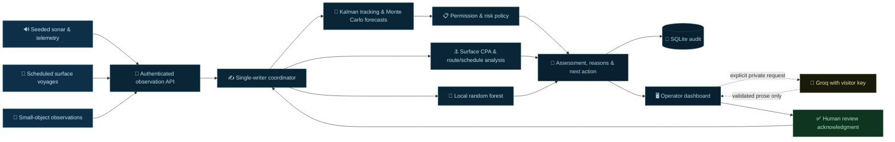

<div align="center">


<br/>

[](https://git.io/typing-svg)

<br/>

<!-- Badges row 1 -->
[](https://python.org)
[](https://streamlit.io)
[](https://fastapi.tiangolo.com)
[](https://docker.com)

<!-- Badges row 2 -->
[](https://huggingface.co/spaces)
[](LICENSE)
[](https://github.com/enlightenedscholar777-dev/The-Argonauts-Hackathon)
[](docs/RELEASE_VALIDATION.md)

<br/>

> **From harbor observations to explainable recommendations.**  
> Harbor-maester is a CPU-first decision-support research prototype by **The Argonauts**.  
> It connects scheduled vessel traffic, synthetic sonar & telemetry, a numerical decision engine,  
> and a live operator dashboard — all deployable in a single Docker container.

<br/>

</div>

---

## ⚡ Quick Start

<details open>
<summary><strong>🐳 Docker &nbsp;·&nbsp; same entry point as Hugging Face Spaces</strong></summary>

```sh
docker build -t harbor-maester .
docker run --rm --name harbor-maester -p 127.0.0.1:7860:7860 harbor-maester
```

Open **http://localhost:7860** — no API key needed for the simulation, tracking, forecasts, policy or motion classifier.

</details>

<details>
<summary><strong>🐍 Local Python development &nbsp;·&nbsp; Python 3.13</strong></summary>

```powershell
# Windows PowerShell
python -m venv .venv
.\.venv\Scripts\python.exe -m pip install -r requirements-space-lock.txt
.\.venv\Scripts\python.exe -m pip install --no-deps --no-build-isolation -e .
.\.venv\Scripts\python.exe -m scripts.launch_demo
```

```bash
# Linux / macOS
python3 -m venv .venv
.venv/bin/python -m pip install -r requirements-space-lock.txt
.venv/bin/python -m pip install --no-deps --no-build-isolation -e .
.venv/bin/python -m scripts.launch_demo
```

Open **http://127.0.0.1:8501**.  Ctrl+C stops both services.

</details>

<details>
<summary><strong>🔑 Optional AI explanations &nbsp;·&nbsp; your own Groq key</strong></summary>

1. Expand **Your Groq API key** in the sidebar
2. Paste your key → click **Use my key**
3. Open **Contacts → Optional AI explanation → Request AI explanation**

Your key stays in that browser session's server memory only — never written to disk, database, or shown to other visitors. Remove it when done. The engine and all core functions continue without any key.

</details>

---

## 🗺️ System Architecture



<div align="center">

| Component | Method | Output |
|:---|:---|:---|
| **Track estimation** | 4-state constant-velocity Kalman filter · Mahalanobis gating · Joseph covariance update | Position, velocity, uncertainty & evidence quality |
| **Conditional forecasting** | Mean propagation + 32 Monte Carlo paths over 30-second horizon | Zone-entry times & sampled hit fractions |
| **Decision policy** | Mission permissions · freshness gates · route hysteresis · reason/action rules · incident lifecycle | Risk band, evidence refs, recommendation & review request |
| **Surface analysis** | Closest point of approach · cross-track distance · schedule delay | Encounter, off-route & delay advisories |
| **Motion classifier** | 48-tree random forest · 7 motion features · abstention on weak evidence | Movement category, model scores & candidate object types |
| **Optional explanation** | Retrieved demo procedures + schema-validated LLM output | Evidence-based narrative — never a control decision |

</div>

---

## 🎮 Operator Workflow

```
┌─────────────┐    ┌──────────────┐    ┌─────────────┐    ┌──────────────┐    ┌──────────────┐    ┌───────────────┐
│  1 Overview │───▶│  2 Contacts  │───▶│  3 Traffic  │───▶│ 4 Simulation │───▶│  5 Activity  │───▶│  6 Detection  │
│             │    │              │    │             │    │              │    │              │    │               │
│ Priority    │    │ Evidence     │    │ Voyages     │    │ Scenarios    │    │ Observation  │    │ Motion        │
│ contact     │    │ Permission   │    │ Encounters  │    │ Fault inject │    │ delivery     │    │ hypotheses    │
│ Atlas map   │    │ Forecast     │    │ Route dev.  │    │ Playback     │    │ Core health  │    │ Feature evid. │
│ Attention   │    │ AI explain.  │    │ Berth delay │    │ Pace control │    │ Audit trail  │    │ Verification  │
└─────────────┘    └──────────────┘    └─────────────┘    └──────────────┘    └──────────────┘    └───────────────┘
```

> [!NOTE]
> The public instance is **one shared exercise** — scenario controls affect all viewers. AI keys and personal explanations are isolated per browser session.

---

## 📊 Evaluation Results

<div align="center">

| 🧪 Experiment | 📈 Result | 🔍 Interpretation |
|:---|:---:|:---|
| Seeded restricted-area approach | **15 s lead** | High concern at t=36 s; zone entry estimated at t=51 s |
| Synthetic sonar outage | **13 s / 20 s** | Report stale at 13 s, lost at 20 s after last ping at t=9 s |
| Motion classification accuracy | **96.5%** | On 800 held-out synthetic trajectories across 4 classes |
| Motion abstention coverage | **97%** | Confidence & margin checks withhold on weak evidence |
| Automated test suite | **93 tests** | Engine, API, tracking, AI isolation & dashboard interactions |

</div>

> [!CAUTION]
> Results are synthetic-only. The 96.5% figure is not real-world debris accuracy. Field data, independent validation and responder studies remain future work.

---

## 🔒 Security & Privacy Model

```
Visitor browser          Container server         Groq API
      │                        │                      │
      │  ── HTTPS ──────────▶  │                      │
      │   (masked key input)   │                      │
      │                        │ key in session RAM   │
      │  ── click Explain ──▶  │                      │
      │                        │  ── evidence + key ──▶│
      │                        │  ◀── validated prose ─│
      │  ◀── prose only ─────  │                      │
      │                        │                      │
      │  (page refresh)        │ session may reset    │
      │  (other visitor)       │ completely isolated  │
```

- 🔑 Keys live only in server session RAM — not disk, DB, logs or repo
- 🚫 Engine AI provider is `off` in the public container — no host key ever set  
- 🛡️ `.dockerignore` is an allowlist — local `.env`, SQLite and test fixtures never enter the image
- 👁️ Simulation state is shared; AI explanations are strictly per-session

---

## 🗂️ Repository Guide

<div align="center">

| Path | Responsibility |
|:---|:---|
| `src/harbor_engine/` | Authoritative engine, API, numerical models, policy, persistence & AI validation |
| `harbor_simulation/` | Operator dashboard, API bridge, scheduled traffic & object generators |
| `simulator/` | Original Pako simulator and reusable sonar/telemetry sensors |
| `config/demo_policy.yaml` | Versioned synthetic policy, zones, source intervals & thresholds |
| `scripts/` | Launchers, evaluation, training & allowlisted deployment export |
| `docs/` | Architecture, model cards, API contract, deployment & measured limitations |
| `project-website/` | Static technical website published through GitHub Pages |

</div>

📖 Deep dives: [Architecture & Math](docs/ARCHITECTURE.md) · [Model & Data Card](docs/MODEL_CARD.md) · [Security Boundaries](docs/SECURITY.md) · [Deployment Guide](docs/DEPLOYMENT.md) · [Release Validation](docs/RELEASE_VALIDATION.md)

---

## 👥 The Argonauts

<div align="center">

Built for the **Preparing for Disaster** hackathon.

<br/>

[](https://www.linkedin.com/in/siddharth-magesh/)
[](https://www.linkedin.com/in/snigdha-bolisetty/)
[](https://www.linkedin.com/in/francisco-anaya-esquivel-23664036b/)

<br/>


</div>
