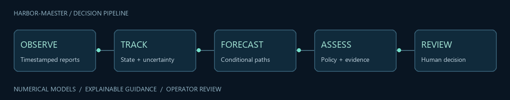
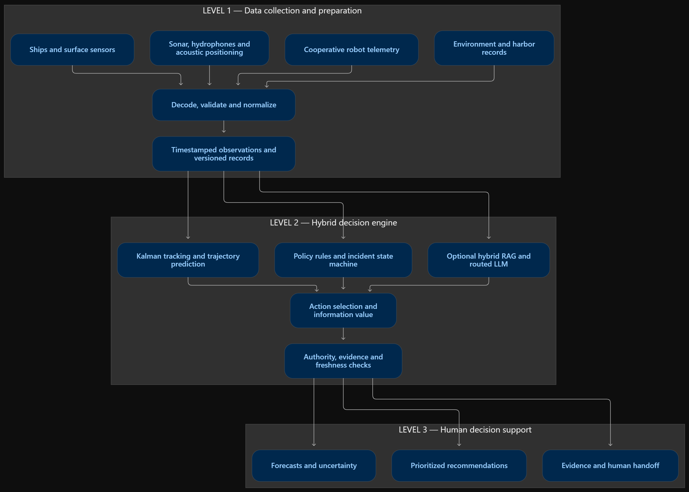
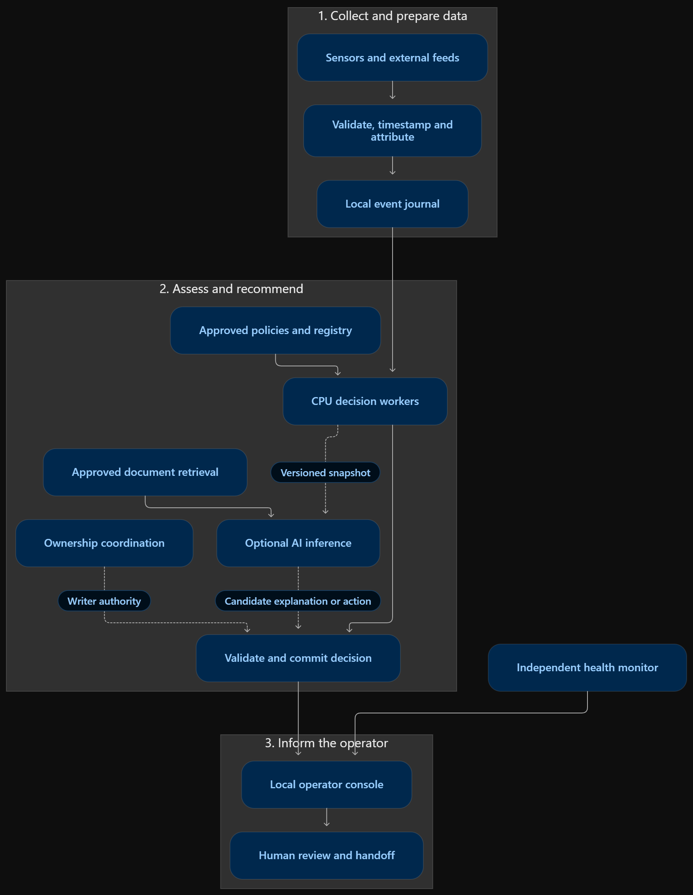
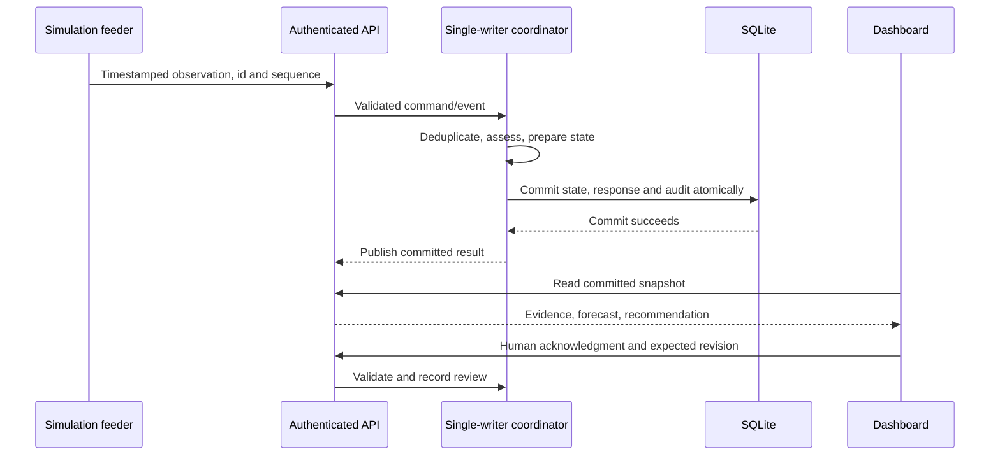

<div align="center">

# Harbor-maester

### Evidence-aware decision support for harbor operations

**Observe movement. Anticipate change. Explain the next decision.**

[](https://harbor-maester.onrender.com/)
[](https://enlightenedscholar777-dev.github.io/The-Argonauts-Hackathon/)
[](docs/ARCHITECTURE.md)




<sub>Conceptual pipeline animation. CPU assessments, synthetic exercises, human review.</sub>

</div>

Harbor-maester is a CPU-first decision-support research prototype that converts timestamped harbor observations — sonar contacts, cooperative telemetry, scheduled surface-vessel traffic and small-object position reports — into inspectable, advisory assessments for a human operator. It tracks motion with a Kalman filter, forecasts zone entry with Monte Carlo trajectories, enforces permission and freshness policies, classifies small-object behavior with a local random forest, and presents everything through a live Streamlit operator console with full audit persistence.

Built by **The Argonauts** for the *Preparing for Disaster* hackathon.

---

## Table of contents

- [Architecture](#architecture)
- [Core capabilities](#core-capabilities)
- [Quick start](#quick-start)
- [Operator workspace](#operator-workspace)
- [Optional AI explanations](#optional-ai-explanations)
- [Evaluation results](#evaluation-results)
- [Render deployment](#render-deployment)
- [Technical tags](#technical-tags)
- [Repository structure](#repository-structure)
- [Documentation](#documentation)
- [Security and privacy](#security-and-privacy)
- [Limitations](#limitations)
- [Team](#team)

---

## Architecture

The system is organized in three layers: data collection, hybrid decision engine and human decision support.

<p align="center">
  
</p>

**Data collection** — Sonar bearing and range observations are converted to a local metric frame. Cooperative telemetry provides heartbeat confirmation. Surface vessels follow scheduled geographic waterway routes. Small-object positions arrive as a separate stream. Inputs are validated, timestamped and deduplicated; assessments and audit records are committed before publication.

**Hybrid decision engine** — A single-writer coordinator owns the state machine. Observations update a constant-velocity Kalman filter; forecasts project 32 Monte Carlo trajectories through policy zones; a rule-based policy layer evaluates permissions, freshness, route deviation and risk. An optional LLM (Groq) provides structured explanations but cannot change risk scores, permissions or recommended actions.

**Human decision support** — The operator dashboard presents prioritized contacts, uncertainty-annotated maps, traffic advisories, motion hypotheses and an audit trail. Acknowledgment is a revision-checked, persisted human handoff — not dispatch or vessel control.

<p align="center">
  
</p>



---

## Core capabilities

| Component | Method | Output |
|---|---|---|
| **State estimation** | 4-state constant-velocity Kalman filter with Mahalanobis gating and Joseph covariance update | Position, velocity, uncertainty and evidence quality |
| **Conditional forecasting** | Mean trajectory propagation + 32 seeded Monte Carlo paths over a 30-second horizon | Zone-entry time estimates and sampled hit fractions |
| **Decision policy** | Mission permissions, freshness gates, route-deviation hysteresis, reason/action rules, incident lifecycle | Risk band, evidence references, recommended next action |
| **Surface traffic analysis** | Closest point of approach, cross-track distance, schedule-delay detection | Close-approach, off-route and delay advisories |
| **Motion classification** | 48-tree random forest over 7 smoothed trajectory features, with multi-criteria abstention | Drift / directed / swimming-like / stationary hypothesis |
| **Optional AI explanation** | BM25 procedure retrieval + schema-validated LLM output (Groq) | Evidence-based narrative — never a control decision |

---

## Quick start

### Local development (Python 3.13)

**Windows PowerShell**
```powershell
python -m venv .venv
.\.venv\Scripts\python.exe -m pip install -r requirements-space-lock.txt -r requirements-lock.txt
.\.venv\Scripts\python.exe -m pip install --no-deps --no-build-isolation -e .
.\.venv\Scripts\python.exe -m scripts.init_env
.\.venv\Scripts\python.exe -m scripts.launch_demo
```

**Linux / macOS**
```bash
python3 -m venv .venv
.venv/bin/python -m pip install -r requirements-space-lock.txt -r requirements-lock.txt
.venv/bin/python -m pip install --no-deps --no-build-isolation -e .
.venv/bin/python -m scripts.init_env
.venv/bin/python -m scripts.launch_demo
```

Open **http://127.0.0.1:8501**. The launcher starts the decision engine on port 8000 (loopback only) and the Streamlit dashboard on port 8501. Ctrl+C stops both services. No API key is needed for simulation, tracking, forecasting, policy or the motion classifier.

---

## Operator workspace

The dashboard provides six integrated views:

| View | Purpose |
|---|---|
| **Overview** | Priority contact, plain-language situation summary, suggested next step, assessed-contact count, attention queue and harbor atlas |
| **Contacts** | Per-contact evidence, mission permission, position age, forecast, risk, recommendation, incident acknowledgment and optional AI explanation |
| **Traffic** | Harbor-wide close-approach advisories, route-deviation and schedule-delay assessments, voyage state and durable review acknowledgment |
| **Simulation** | Nine scenario presets (harbor approach, route deviation, sensor outage, conflicting reports, busy harbor, etc.), configurable traffic density, playback speed, pause/step, sensor and AI fault injection |
| **Activity** | Core/storage/provider health, observation delivery receipts, age history and committed audit records |
| **Detection** | Small-object motion hypotheses, smoothed trajectory features, model scores, candidate object types and verification suggestions |

Simulation state is shared across viewers. AI explanations are strictly per-session.

---

## Optional AI explanations

The CPU engine provides complete deterministic assessments without any LLM. For optional natural-language explanations:

1. Expand **Your Groq API key** in the dashboard sidebar
2. Paste your key and click **Use my key**
3. Open a contact and select **Request AI explanation**

Your key is held only in server session memory for that browser session — it is never written to disk, the database, logs or the repository. Remove the key when finished. The engine and all core functions continue without any key.

---

## Evaluation results

| Experiment | Result | Detail |
|---|---|---|
| Seeded restricted-area approach | 15 s warning lead | High concern at t=36 s; zone entry estimated at t=51 s |
| Synthetic sonar outage | 13 s / 20 s freshness | Stale at 13 s, lost at 20 s after last observation at t=9 s |
| Motion classification accuracy | 96.5% | On 800 held-out synthetic trajectories across 4 classes |
| Motion abstention coverage | 97% | Confidence and margin checks withhold on weak evidence |
| Automated test suite | 93 tests passing | Engine, API, tracking, AI isolation and dashboard interactions |

> **Note:** All results are on synthetic data. The 96.5% accuracy is not a real-world debris-detection figure. Field data, independent validation and responder studies remain future work.

---

## Render deployment

**Live application:** [harbor-maester.onrender.com](https://harbor-maester.onrender.com/)

**Product and research website:** [Harbor-maester research brief](https://enlightenedscholar777-dev.github.io/The-Argonauts-Hackathon/)

The Render service is defined in [`render.yaml`](render.yaml). Its launch command is:

```bash
python app.py
```

The root `app.py` starts the decision API on internal loopback port `8000` and exposes Streamlit on Render's `PORT`, defaulting to `7860` locally. The operator dashboard lives in `harbor_simulation/app.py`.

| Render setting | Value |
|---|---|
| Runtime | Python |
| Build command | `pip install -r requirements-space.txt` |
| Start command | `python app.py` |
| Health check | `/_stcore/health` |
| Public AI credentials | Visitor-provided key through the dashboard |

The existing Render start command remains `python app.py`. The launcher reads `PORT` automatically and keeps engine credentials internal.

The public demo runs one shared synthetic exercise. Scenario controls affect all viewers; Groq keys and private explanations are scoped to each browser session. Core tracking, forecasts and recommendations work without an API key. See the [deployment guide](docs/DEPLOYMENT.md) for setup and service checks.

---

## Repository structure

```
├── render.yaml                   # Render service configuration
├── pyproject.toml                # Package metadata and dependencies
├── requirements-space-lock.txt   # Pinned runtime dependencies
│
├── src/harbor_engine/            # Decision engine, API, numerical models,
│   ├── tracking.py               #   Kalman filter and state estimation
│   ├── forecast.py               #   Monte Carlo trajectory forecasting
│   ├── policy.py                 #   Permission, risk and freshness rules
│   ├── surface.py                #   CPA, route and schedule analysis
│   ├── motion.py                 #   Random-forest motion classification
│   ├── coordinator.py            #   Single-writer state machine
│   ├── storage.py                #   SQLite persistence and audit
│   ├── api.py                    #   FastAPI endpoint definitions
│   ├── ai/                       #   Optional Groq AI worker
│   └── models/                   #   Trained motion-forest JSON artifact
│
├── harbor_simulation/            # Operator dashboard and simulation
│   ├── app.py                    #   Streamlit application
│   ├── integration.py            #   API bridge and scenario controller
│   ├── views.py                  #   Atlas, geographic and exercise maps
│   ├── traffic.py                #   Surface-vessel voyage scheduling
│   └── personal_ai.py            #   Per-session visitor key handling
│
├── simulator/                    # Pako sonar/telemetry sensor generators
├── config/demo_policy.yaml       # Synthetic policy, zones and thresholds
├── data/procedures.json          # Demo retrieval procedures
├── scripts/                      # Launchers, evaluation and training
├── project-website/              # Static site (GitHub Pages)
├── docs/                         # Architecture, model card, security, API
└── tests/                        # Engine, API and dashboard test suite
```

---

## Documentation

| Document | Content |
|---|---|
| [Architecture and mathematical methods](docs/ARCHITECTURE.md) | Kalman filter equations, Monte Carlo forecasting, CPA formulation, policy rules, coordinate contracts |
| [API contract](docs/API_CONTRACT.md) | Every endpoint, role, request/response schema, error code and retry behavior |
| [Model and data card](docs/MODEL_CARD.md) | Random-forest training procedure, feature definitions, evaluation metrics and limitations |
| [Motion detection](docs/MOTION_DETECTION.md) | Small-object observation stream, classification pipeline, harbor-area selection and abstention criteria |
| [Security boundaries](docs/SECURITY.md) | Visitor key isolation, shared-state model, credential scanning and storage lifecycle |
| [Deployment guide](docs/DEPLOYMENT.md) | Local development, Render configuration and GitHub Pages |
| [Capability audit](docs/CAPABILITY_AUDIT.md) | Crisis-mitigation criteria, implemented algorithms vs. claims, measured evaluation and remaining work |

---

## Security and privacy

- **Visitor keys** are held in server session memory only — never disk, database, logs or the repository
- **Engine AI provider** is forced `off` on the public deployment; no host key is ever set
- **Credential scanning** runs as a pre-release check across all source files
- **Session isolation** — AI explanations are per-browser-session; simulation state is shared
- **Upload bundles** are built from an explicit allowlist; `.env`, SQLite, test fixtures and ground-truth data are excluded

---

## Limitations

This is a research prototype, not a production vessel traffic service.

- Sensor observations are synthetic; routes and policy zones are illustrative within real Long Beach geographic context
- Acknowledgment is audited human review, not dispatch, vessel control or navigation clearance
- The 96.5% motion accuracy is on synthetic trajectories; real-world performance is unmeasured
- No raw sensor detection, identity recognition, material classification or species identification
- Surface thresholds are demonstration values, not COLREGs or certified navigation criteria
- Single shared exercise per deployment; no multi-tenant isolation or production RBAC
- Container storage is ephemeral; history may be lost on service restart

See [docs/CAPABILITY_AUDIT.md](docs/CAPABILITY_AUDIT.md) for a detailed assessment of what is and is not implemented.

---

## Technical tags

Methods and engineering concepts implemented in the prototype. These labels describe the software; they do not imply operational certification.

**Estimation and forecasting**


**Motion modeling and simulation**


**Decision support and explanations**


**Runtime and reliability**


---

## Team

**The Argonauts** — *Preparing for Disaster* hackathon

<a href="https://www.linkedin.com/in/siddharth-magesh/"><strong>Siddharth Magesh</strong></a> · <a href="https://www.linkedin.com/in/snigdha-bolisetty/"><strong>Snigdha Bolisetty</strong></a> · <a href="https://www.linkedin.com/in/francisco-anaya-esquivel-23664036b/"><strong>Francisco Anaya Esquivel</strong></a>
