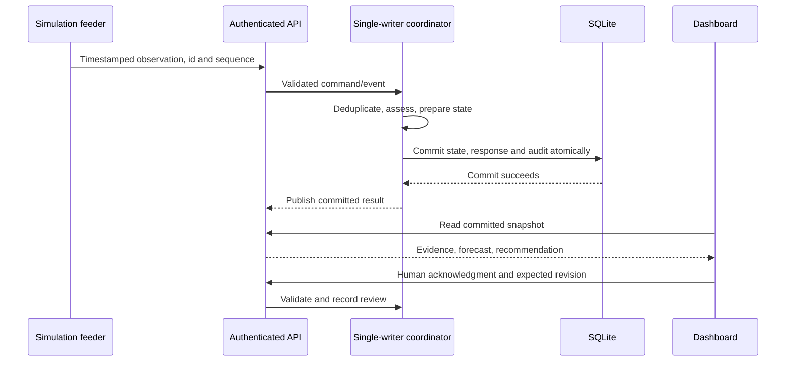

# Harbor-maester — architecture and mathematical methods

## 1. Objective and decision boundary

Harbor-maester converts timestamped observations into inspectable, advisory assessments. The primary computation is a bounded CPU pipeline. A language model is an optional explanation service and cannot set mission permission, risk or the primary recommended action. Tracking uncertainty is numerical, permission is a policy decision, and an object-type suggestion is an interpretation of motion rather than an identity measurement.

Three observation streams share storage and presentation while retaining distinct semantics: sonar contacts with cooperative telemetry; scheduled surface-vessel reports; and small-object position reports. Surface traffic does not inherit underwater mission permissions. Small-object classification does not authorize activity or assign hostile intent.

## 2. Runtime topology and consistency

The local launcher starts one FastAPI/Uvicorn engine and one Streamlit server. Docker exposes Streamlit on `0.0.0.0:7860`; the engine listens on `127.0.0.1:8000` inside the container. Three randomly generated tokens distinguish sensor, operator and viewer requests between processes. One Uvicorn worker owns the SQLite database.



The coordinator copies state, applies the command, computes assessments, commits the transaction, then publishes. A failed commit does not publish prepared state. Stable command and event identifiers support idempotent retry; reusing an identifier with a different payload is rejected. Source sequence and boot identifiers distinguish duplicates, gaps and restarts. A database ownership lock prevents competing writers.

## 3. Observation and coordinate contracts

The sonar bridge converts measured range and bearing into a local metric frame, with north as zero bearing. A bearing without measured range is rejected because it does not determine Cartesian position. Reported uncertainty combines radial and tangential contributions conservatively. Depth is excluded from the current 2D contract.

Eight geographic anchors project the local demonstration frame into Long Beach harbor areas. Local policy geometry is illustrative, not a surveyed navigation chart. Surface voyages follow explicit geographic waterway routes; moving a local exercise frame does not relocate those routes or create a new port model.

## 4. State estimation

For each sonar track:

```text
x = [px, py, vx, vy]^T
F(dt) = [[1,0,dt,0], [0,1,0,dt], [0,0,1,0], [0,0,0,1]]
H = [[1,0,0,0], [0,1,0,0]]
G(dt) = [[dt²/2,0], [0,dt²/2], [dt,0], [0,dt]]
Q = sigma_acceleration² G G^T
R = sigma_measurement² I₂
```

Prediction is `x- = F x` and `P- = F P F^T + Q`. Innovation is `y = z - H x-`, with covariance `S = H P- H^T + R`. The squared Mahalanobis distance `d² = y^T S^-1 y` is compared with the configured innovation gate. Rejected observations increment conflict evidence rather than teleporting the estimate.

For an accepted observation, `K = P- H^T S^-1` and `x+ = x- + K y`. Covariance uses the Joseph form:

```text
P+ = (I-KH) P- (I-KH)^T + K R K^T
```

The implementation symmetrizes covariance and checks finite values and positive-semidefinite tolerance. Velocity becomes established after at least three accepted observations spanning two seconds. See [`tracking.py`](../src/harbor_engine/tracking.py).

## 5. Conditional forecasts

The estimate is projected to assessment time, then along a constant-velocity mean trajectory with Gaussian acceleration noise. The default horizon is 30 seconds at two-second intervals. Segment/polygon intersection estimates first entry into each policy zone.

Thirty-two Monte Carlo paths sample state covariance and successive process noise. Reproducible seeds combine the exercise seed, track identifier and timestamps. The fraction intersecting a zone is a **conditional, uncalibrated sampled hit fraction**, not an operational incident probability. The uncertainty radius is twice the square root of the largest positional-covariance eigenvalue; it is not a 95% joint coverage guarantee.

Forecasts are withheld when evidence is too old or velocity is not established. See [`forecast.py`](../src/harbor_engine/forecast.py), [`geometry.py`](../src/harbor_engine/geometry.py) and the [policy configuration](../config/demo_policy.yaml).

## 6. Policy, freshness and review

The policy layer evaluates source freshness, tracking conflict, confirmed mission bindings, permitted routes/zones and geometric forecasts. Mission confirmation is not blanket access to every zone. Unknown identity alone is not proof of hostile intent. Explicit reasons drive recommended evidence gathering or review.

Route hysteresis avoids changing deviation state around one noisy threshold. The incident lifecycle records review demand and acknowledgment independently of moving coordinates. Acknowledgment uses the expected core revision, records human ownership and leaves monitoring active. No dispatch, external message or actuator command is sent.

A semantic digest captures decision-relevant conditions. Server-side AI results are discarded when session generation or semantic basis no longer matches. Private explanations also re-read context after generation and reject obsolete or stale evidence. Results retain assessment time and revision so prose is not mistaken for a newly calculated risk decision.

## 7. Surface traffic analysis

For relative position `r = pb - pa` and velocity `v = vb - va`:

```text
tCPA = clip(-(r · v)/(v · v), 0, 120 seconds)
dCPA = ||r + v tCPA||
```

Near-zero relative speed uses current separation. The demo considers pairs currently within 1,500 m and warns when predicted separation is below 120 m. Route cross-track distance above 140 m and schedule delay of at least 30 seconds produce separate advisories. These are synthetic thresholds, not COLREGs or certified navigation criteria. Pair evaluation is O(n²), bounded by the demo's 100-voyage limit. Hull geometry, braking, tides and future turns are not modeled.

The simulator generates lane-following voyages with arrival scheduling, off-map queues, berth service and separation constraints. CSV records seed identity and operational profiles; they contain no positions and are not replayed AIS. Pako's sensor implementation supplies sonar and telemetry; the dashboard-era implementation contributes harbor layout and surface context.

## 8. Small-object ML

The local model is a 48-tree random forest, depth at most seven, with at least five training examples per leaf. It classifies seven smoothed trajectory features into drift, directed, swimming-like and stationary behavior. Runtime traversal uses JSON trees and NumPy; no GPU, scikit-learn installation or network is needed for inference.

It abstains on inadequate history, stale observations, excessive measurement uncertainty, feature-envelope violations, a maximum score below 0.65 or a top-two margin below 0.20. Candidate objects are explanatory mappings from behavior, not a second recognition model. Material, species, identity and registration remain unconfirmed. See [model card](MODEL_CARD.md).

## 9. Optional AI and private credentials

The context contains reason codes, selected action, authorization, admissible next-evidence actions, evidence IDs, forecast uncertainty, retrieved demo procedures and a bounded untrusted note. BM25 retrieves demo-authored procedures. JSON-schema validation checks structure; additional checks constrain evidence/procedure references and suggested evidence actions to the supplied context.

On Spaces, a key is stored only in a `PersonalAI` object inside the visitor's Streamlit session state. It never enters the cached controller, process environment, engine commands or SQLite. The dashboard obtains context through an authenticated read-only endpoint, creates a temporary Groq client on explicit request and closes it afterward. Only the newest private explanation is retained. Removing the key drops the object and result.

SDK retries are disabled. A private limiter permits at most three requests per minute and one per contact per 30 seconds, with provider cooldowns honored up to the adapter's existing bound. These limits reduce accidental repeated requests; provider quotas remain authoritative. Errors map to fixed messages without rendering exceptions or keys. Key entry and simulation-fault toggles make no external requests.

## 10. Hosting and scale

One container hosts one collaborative exercise. Browser-session key isolation is not tenant isolation for harbor state: visitors can change the shared synthetic exercise. There is no public-user authentication or production RBAC. Multiple independent organizations need tenant-aware persistence, ingestion, authorization and resource management.

Container disk is temporary unless storage is configured. History may disappear on Space restart/rebuild. A slow CPU can advance scenario time slower than wall time; the dashboard exposes the scenario clock. Real sensor adapters, surveyed geography, threshold calibration, independent evaluation and responder studies remain prerequisites for operational use.
