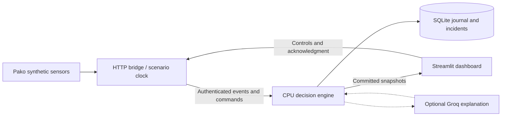

# Integrated visual demo

## What was combined

`v1-demo` starts from the committed decision engine (`258726b`) and merges both remote histories: Dashboard (`c5e078b`) and Pako-Simulator-Branch (`a3b1e48`). The merges were clean; the work was resolving runtime interfaces rather than textual conflicts. Neither `main` nor the original engine branch was changed. Nothing is pushed by this integration task.

| Component | Evaluation and integration choice |
|---|---|
| Dashboard Streamlit simulator | Useful maritime layout, charts, continuity arithmetic and six synthetic datasets. Its observations have no usable track coordinates, its incidents/markers are illustrative, and its AI text is a template. Kept its presentation and traffic context; replaced live risk, health, incident and acknowledgment views with API results. Original app preserved as `harbor_simulation/legacy_app.py`. |
| Pako simulator | Reusable sonar, telemetry, surface vessel and environmental generators. Its separate engine uses an in-memory journal and AI stub, with different units, mission epochs, zones and output schema. Reused its generators and added seeded RNG injection; retained its standalone runner and engine for comparison. |
| Decision engine | Owns filtering, forecasting, authorization, policy, incident lifecycle, SQLite persistence, and optional Groq enrichment. Its API is the sole source of live assessments. |
| Existing engine CLI simulator | `scripts.run_demo` and its eight verification scenarios remain intact for engine-focused demonstrations. |



The bridge converts sonar bearing (north=0°, east=90°) plus measured range into the engine's `harbor_local_m` frame. Measurement sigma conservatively includes both radial and angular error. Bearing-only input is rejected; no location is invented. Two sonar tracks stay inside the engine's existing policy bounds. Pako telemetry supplies cooperative heartbeats every five scenario seconds; it does not silently refresh sonar positions or establish identity. Starting an exercise explicitly confirms the synthetic research mission using the operator binding API. The approaching contact remains unknown.

Surface vessel and current generators appear as context only. The CSV traffic chart and continuity arithmetic also remain separate from engine assessments; hidden ground-truth labels are never loaded by the live app.

One shared controller owns the feeder per Streamlit process. It runs separately from page refreshes, so additional browser tabs do not duplicate observations or advance time. Requests use stable command/event IDs across retries. Poll failures clear live results. Sensor outages stop positions while clock and telemetry continue. Acknowledgments are revision-checked engine commands and persist in SQLite.

## Launch on this Windows laptop

Dependencies have been installed in the existing `.venv`. To reproduce the verified environment:

```powershell
Set-Location D:\The-Argonauts-Hackathon
.\.venv\Scripts\python.exe -m pip install -r requirements-demo-lock.txt
.\.venv\Scripts\python.exe -m pip install -e ".[demo]"
.\.venv\Scripts\python.exe -m scripts.launch_demo
```

Open **http://127.0.0.1:8501**. Engine API docs are at **http://127.0.0.1:8000/docs**. The launcher creates missing local credentials without printing or replacing existing secrets. Credentials stay in the Python server; the browser does not need engine tokens. Both services bind to loopback, so this is a local operator console, not a network-authenticated multi-user deployment.

The launcher defaults to `AI_PROVIDER=off`, manual demo sessions, one engine worker, and `runtime/v1-demo.sqlite3`. It does not reuse or reset `runtime/harbor_demo.sqlite3`. Logs are `runtime/v1-demo-engine.log` and `runtime/v1-demo-dashboard.log`. Ctrl+C terminates only the launcher's child processes and preserves committed data. The launcher refuses occupied ports rather than killing their owners.

Alternate ports or a separate database:

```powershell
.\.venv\Scripts\python.exe -m scripts.launch_demo --engine-port 8010 --dashboard-port 8510 --database runtime/alternate-demo.sqlite3
```

After restarting, a recovered active session is displayed without automatically taking over its feeder. Select **Stop active exercise**, then **Start exercise** to begin a new one. The old session remains in SQLite. Starting while any session is active refuses to replace it.

## Presentation in two minutes

1. Start **Harbor approach**, with **Run automatically** checked. Research stays on its permitted route; the unknown contact moves toward `restricted_01`. Every dot and forecast is an engine estimate, not a hand-positioned incident marker.
2. Around 20–40 scenario seconds, inspect the unknown contact's rising risk and recommended action. Press **Pause** to explain its evidence, forecast and incident packet. **Step +1s** advances precisely one scenario second.
3. Press **Acknowledge human handoff**. The incident changes to `HUMAN_OWNED` in the engine and audit journal.
4. Enable **Replay duplicate observations**, then step. The duplicate counter increases; each replay returns the engine's `DUPLICATE` receipt.
5. Press **Lose sonar coverage**, then resume or step 12 times. Position evidence becomes stale and then `LOST`, even though telemetry continues. Restore sonar to recover fresh positions.
6. Stop the exercise explicitly. Start **Research route deviation** to show that confirmed identity does not exempt a vehicle from route constraints; its turn begins after 15 seconds.

Automatic playback advances one scenario second per completed step, paced at roughly one step per wall second. Pause freezes the scenario clock, including freshness; it does not simulate sensor loss. Each exercise pauses at 90 scenario seconds for inspection. The offline local map is the default. The optional Long Beach basemap needs internet and uses an explicitly illustrative projection; it has no effect on decisions.

## AI modes

The CPU engine is real numerical tracking and rule-based decision support. It is not a learned threat classifier. No GPU or local model weights are needed.

Default `--ai off` makes no LLM calls. For a repeatable outage demonstration without any external service:

```powershell
.\.venv\Scripts\python.exe -m scripts.launch_demo --ai fake
```

`fake` is visibly labeled **MOCK**, not real inference. Its demo-only call limits are relaxed for quick feedback. Start an exercise, select **Simulate AI unavailable**, and observe the AI status change while CPU recommendations continue. Faults expire after five wall-clock minutes. Clear the fault and use **Request AI explanation** after any remaining circuit cooldown.

For real hosted Groq inference, install the optional SDK and set `GROQ_API_KEY` privately in `.env`:

```powershell
.\.venv\Scripts\python.exe -m pip install -r requirements-groq-lock.txt
.\.venv\Scripts\python.exe -m scripts.launch_demo --ai groq
```

The configured model is `openai/gpt-oss-20b`. This mode can make billable external requests. It preserves the engine's conservative rate, token, timeout and session budgets. Missing keys/SDK, rejected responses, network errors and rate limits leave the deterministic engine running. An AI request may be skipped during cooldown or when budgets are exhausted; the dashboard reports provider status and still shows the CPU explanation. Optional generated explanations are visibly separate and cannot change risk, permissions or the primary action.

## Verification and practical limits

```powershell
.\.venv\Scripts\python.exe -m pytest tests simulator/tests -q
.\.venv\Scripts\python.exe -m scripts.launch_demo --check --engine-port 8015 --dashboard-port 8515 --database runtime/startup-check.sqlite3
.\.venv\Scripts\python.exe -m pip check
```

The integration suite checks real Pako observations against the engine, range/bearing conversion, authorization, approaching-zone handoff, acknowledgment, duplicates, sonar loss with continuing telemetry, recovery, route deviation, and background feeder pause behavior. Streamlit widget tests run against an actual Uvicorn process over loopback HTTP in AI-off, fake-outage, and missing-Groq-key modes. They verify displayed assessments, button effects, durable acknowledgments and removal of current results after an engine disconnect. The tests use [Streamlit's AppTest interface](https://docs.streamlit.io/develop/api-reference/app-testing/st.testing.v1.apptest).

Validation on this laptop: **80 tests passed** across the engine, integration, dashboard and preserved Pako suite; both services passed the launcher's HTTP readiness check; Ruff and `pip check` passed. The full suite completed in about 32 seconds on CPU. Existing engine benchmark results remain in `benchmark-results.json`; they are engine-only measurements, not a dashboard frame-rate benchmark.

Remaining limits: no live Groq call was verified without a supplied key; no browser surface was available for visual screenshot QA. Streamlit rendering and controls were checked through AppTest, and both service health endpoints through actual HTTP. There are two live decision tracks, one context vessel, fixed synthetic policy and no real harbor sensors. The original Pako prototype's bearing-only EKF, AI stub and broader production TODOs remain outside this integrated path. No remote deployment, production authentication, or push to origin is included.
