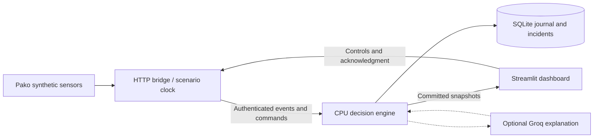

# Harbor-maester — integrated operator demo

Current capabilities, measured results and limits are documented in [the capability audit](CAPABILITY_AUDIT.md). The harbor-wide and motion-detection update passed all 93 tests and headless browser checks. Surface traffic is now assessed by the engine; earlier integration notes below describe its original context-only design.

**New: [small-object Detection and selectable harbor areas](MOTION_DETECTION.md).** Simulation now supports eight exercise locations and either harbor-wide or single-area object observations. Detection appears below Activity and uses a bundled CPU random forest even with `--ai off`. Its hypotheses describe movement; they do not identify material, species or registration. Restart the services and start a fresh exercise to enable the new stream in an older recovered session.

## What was combined

`v1-demo` starts from the committed decision engine (`258726b`) and merges both remote histories: Dashboard (`c5e078b`) and Pako-Simulator-Branch (`a3b1e48`). The merges were clean; the work was resolving runtime interfaces rather than textual conflicts. Neither `main` nor the original engine branch was changed. Nothing is pushed by this integration task.

| Component | Evaluation and integration choice |
|---|---|
| Dashboard Streamlit simulator | Useful maritime layout, charts, continuity arithmetic and six synthetic datasets. Its observations have no usable track coordinates, its incidents/markers are illustrative, and its AI text is a template. Kept its presentation and traffic context; replaced live risk, health, incident and acknowledgment views with API results. Original app preserved as `harbor_simulation/legacy_app.py`. |
| Pako simulator | Reusable sonar, telemetry, surface vessel and environmental generators. Its separate engine uses an in-memory journal and AI stub, with different units, mission epochs, zones and output schema. Reused its generators and added seeded RNG injection; retained its standalone runner and engine for comparison. |
| Decision engine | Owns filtering, forecasting, authorization, policy, incident lifecycle, SQLite persistence, and optional Groq enrichment. Its API is the sole source of live assessments. |
| Existing engine CLI simulator | `scripts.run_demo` and its eight verification scenarios remain intact for engine-focused demonstrations. |



The bridge converts sonar bearing (north=0°, east=90°) plus measured range into the engine's `harbor_local_m` frame. Measurement sigma conservatively includes both radial and angular error. Bearing-only input is rejected; no location is invented. The approach preset has two sonar tracks; Busy harbor has eight, all within the existing policy bounds. Pako telemetry supplies cooperative heartbeats every five scenario seconds; it does not silently refresh sonar positions or establish identity. Starting an exercise (including automatic demo startup) confirms the synthetic research mission using the operator binding API. Other contacts remain unknown.

Surface vessel and current generators appear as context only. The original CSV traffic chart and continuity arithmetic remain in the preserved legacy dashboard; hidden ground-truth labels are never loaded by the live app.

One shared controller owns the feeder per Streamlit process. It runs separately from page refreshes, so additional browser tabs do not duplicate observations or advance time. Requests use stable command/event IDs across retries. Poll failures clear live results. Sensor outages stop positions while clock and telemetry continue. Acknowledgments are revision-checked engine commands and persist in SQLite.

## Launch on this Windows laptop

Dependencies have been installed in the existing `.venv`. To reproduce the verified environment:

```powershell
Set-Location D:\The-Argonauts-Hackathon
.\.venv\Scripts\python.exe -m pip install -r requirements-demo-lock.txt
.\.venv\Scripts\python.exe -m pip install -e ".[demo]"
.\.venv\Scripts\python.exe -m scripts.launch_demo
```

Open **http://127.0.0.1:8501**. Engine API docs are at **http://127.0.0.1:8000/docs**. The launcher creates missing local credentials without printing or replacing existing secrets. Credentials stay in the Python server; the browser does not need engine tokens. Both services bind to loopback, so this is a local operator console, not a network-authenticated multi-user deployment.

The launcher defaults to `AI_PROVIDER=off`, manual demo sessions, one engine worker, and `runtime/v1-demo.sqlite3`. It does not reuse or reset `runtime/harbor_demo.sqlite3`. Logs are `runtime/v1-demo-engine.log` and `runtime/v1-demo-dashboard.log`. Ctrl+C terminates only the launcher's child processes and preserves committed data. The launcher refuses occupied ports rather than killing their owners.

Alternate ports or a separate database:

```powershell
.\.venv\Scripts\python.exe -m scripts.launch_demo --engine-port 8010 --dashboard-port 8510 --database runtime/alternate-demo.sqlite3
```

When the dashboard first opens with no active session, **Harbor-wide operations** starts automatically with eight sonar contacts and 48 scheduled surface voyages. Visible surface vessels also receive CPU traffic assessments. This happens once per dashboard process; pausing or stopping does not trigger an automatic restart. Set `HARBOR_AUTOSTART=false` to disable this behavior. A recovered active session is displayed without taking over its feeder. In **Simulation**, select **Stop active exercise**, then a preset or **Start selected exercise** to begin a new one. Old sessions remain in SQLite. Presets replace only sessions owned by this dashboard.

## Operator workspace

**Harbor-maester** opens on the operator overview. The application preserves the sonar policy and adds a separate, explicitly labeled surface traffic model through the same engine coordinator and persistence layer.

- **Overview:** priority contact, plain-language situation and suggested next step, assessed-contact count, moving surface traffic, position freshness, live maps and an attention queue. The queue uses existing handoff, risk and action fields. A low-concern unidentified contact can need permission verification without being classified as a high concern.
- **Contacts:** search and filter contacts, read the recommendation and evidence, check mission permission and position age, acknowledge an incident review, and optionally request an AI explanation. Acknowledgment is persisted by the engine; monitoring continues. The selected contact's reference matches the labels on the shared exercise map.
- **Traffic:** harbor-wide close-approach, route and delay assessments, voyage schedules and durable review acknowledgment.
- **Simulation:** nine scenario presets, configurable traffic and playback speed, sensor loss, duplicate replay and optional AI outage controls. Pause, resume and single stepping are available across the workspace.
- **Activity:** core/storage/provider health, delivery receipts, observation-age history and committed audit records. Audit history is a loaded snapshot with an explicit refresh button.

The offline atlas remains the default map. Geographic context and exercise detail remain available. Lost/stale/conflicting positions are explained explicitly. A stopped exercise is labeled as final recorded data; connection failure clears current assessments. Mock AI is labeled in the contact explanation panel, and missing Groq credentials leave CPU recommendations available.

Restart an already-running launcher once to load this UI: Ctrl+C, then the same launch command. No additional runtime dependencies are needed.

## Presentation in two minutes

1. Open **Simulation** and select **Harbor approach**, with **Run automatically** checked. Research stays on its permitted route; the unknown contact moves toward `restricted_01`. Every dot and forecast is an engine estimate, not a hand-positioned incident marker.
2. Around 20–40 scenario seconds, inspect the unknown contact's rising risk and recommended action. Press **Pause** to explain its evidence, forecast and incident packet. **Step +1s** advances precisely one scenario second.
3. In **Overview**, select **Review priority contact**, then **Acknowledge review** in **Contacts**. This records acknowledgment; no operational command is sent. The incident changes to `HUMAN_OWNED` in the engine and audit journal.
4. In **Simulation → Test sensor and AI outages**, enable **Replay duplicate observations**, then step. Inspect **Activity**. The duplicate counter increases; each replay returns the engine's `DUPLICATE` receipt.
5. Press **Lose sonar coverage**, then resume or step 12 times. Position evidence becomes stale and then `LOST`, even though telemetry continues. Restore sonar to recover fresh positions.
6. Stop the exercise explicitly. Start **Research route deviation** to show that confirmed identity does not exempt a vehicle from route constraints; its turn begins after 15 seconds.

Automatic playback advances one scenario second per completed step. **Playback speed** selects 1×, 2× or 4× pacing, subject to CPU/API processing time. Pause freezes both the engine clock and surface movement; it does not simulate sensor loss. Focused exercises pause at 90 scenario seconds; Harbor-wide operations runs for 900 seconds.

### Scenario buttons and dataset traffic

The **Simulation** page restores the original Dashboard scenarios and retains the integrated engine scenarios. A preset button archives an active exercise owned by this controller before starting the selected scenario; it refuses to replace an external/recovered active session. History remains in SQLite. The scenario selection follows the clicked preset.

| Preset | Actual simulation behavior |
|---|---|
| Harbor approach / Unverified underwater report | Unknown sonar contact approaches the existing restricted zone beside confirmed research. |
| Normal operations | Confirmed research follows its reference route. |
| Research route deviation | Research turns away from its route after 15 seconds. |
| Conflicting reports | At 10–13 seconds, inconsistent positions exercise the existing outlier rejection and sensor-conflict rules. |
| Sensor outage | Sonar stops at 10 seconds and returns at 30; traffic and telemetry continue. |
| Port operations disruption | At 10 seconds, one quarter of surface vessels hold; the approaching contact continues through the existing assessment pipeline. |
| Busy harbor | Eight simultaneous Pako sonar contacts are assessed by the CPU engine. |

**Surface traffic for next exercise** selects 12–100 scheduled voyages, default 48 in the UI. Profiles are sampled reproducibly from `data/long_beach_dataset_only/synthetic_surface_vessels.csv`, with the existing bundled copy as a fallback. The supplied file has 1,400 rows and 100 distinct vessel IDs and matches the bundled copy. IDs, vessel types, sectors and scheduling states seed generated water-lane motion. There are no position columns, so this is a generated simulation, not replayed AIS. The ground-truth file is never loaded. Surface context is separate from engine-assessed contacts; both counts appear in the dashboard.

The atlas and geographic view share each traffic update. Hull direction, trails, selected vessel labels, scenario time and live assessment summaries make changes visible on the atlas itself. Holding vessels turn amber. Pause and manual stepping use the same scenario clock across both views. Inspect **Surface traffic & dataset** for the source profile and current simulated state.

The default **Harbor atlas** is a detailed offline schematic with 11 named pier areas (A–H, J, S, T), eight waterways/basins, rail and road connections, container/crane symbols, a directory, compass and a live exercise inset. **Geographic map** retains the interactive Long Beach basemap, with matching landmarks and live engine overlays. **Exercise detail** uses the full page width for an equal-scale metre grid, labeled policy zones, reference routes, numbered tracks, speed, observation age, recommended action, heading arrows, forecast time markers and current uncertainty radii. The radii come from the engine's uncalibrated 2-standard-deviation major-axis measure, not a navigation clearance or calibrated confidence boundary.

**Focus area** highlights a pier on the atlas and zooms to its geographic anchor; choose **Exercise area** for the synthetic activity. The sidebar **Map settings** controls labels, fictional traffic, forecasts and uncertainty. Both offline maps remain visible before startup and during API outages; live observations are cleared during outages and traffic returns to a labeled static preview. The geographic tab needs internet/WebGL; disabling **Show online Long Beach basemap** avoids loading it entirely.

Names and relative harbor context follow [City of Long Beach Mobility Element, Map 10](https://www.longbeach.gov/globalassets/lbcd/media-library/documents/planning/advance/general-plan/mobility-element/320615_lbds_mobility_element_web). Facility anchors, shapes and internal assets are illustrative, not surveyed geometry or current berth assignments. Routes and zones are drawn only from the engine snapshot's pinned synthetic policy; no real port restrictions or sensor coverage are implied. No new runtime dependencies are required.

### Blank-map regression fix

The initial integration passed its SVG directly to `st.html`. Streamlit 1.66 sanitizes that content with an HTML-only profile, removing SVG elements in the browser. The initial page also returned before drawing maps when no session existed, and the original basemap was hidden behind an unchecked toggle. Both SVG views now use `st.image` data images, harbor context is visible by default, and maps render before startup and during API outages. During an outage only static context remains; old live tracks are cleared. Regression tests inspect the actual image data URLs and serialized map layers, not just the generated SVG string. Standalone rendered images were visually inspected as well.

After updating the code, restart the launcher once (Ctrl+C, then the same launch command) and refresh the page. The presentation launcher deliberately disables file watching, so an already-running dashboard does not load source edits automatically.

The subsequent geographic-map failure was reproduced in Edge: unquoted pydeck strings serialized `widthUnits` as `@@=pixels` and text alignment as `@@=start`. That produced giant paths covering the map and text-layer attribute errors. Both are now serialized as literal strings. Regression assertions cover these exact properties, and headless Edge verified the actual Carto map, moving atlas, pause and scenario switching without browser errors.

## AI modes

The CPU engine is real numerical tracking and rule-based decision support. It is not a learned threat classifier. No GPU or local model weights are needed.

Default `--ai off` makes no LLM calls. For a repeatable outage demonstration without any external service:

```powershell
.\.venv\Scripts\python.exe -m scripts.launch_demo --ai fake
```

`fake` is visibly labeled **MOCK**, not real inference. Its demo-only call limits are relaxed for quick feedback. In **Simulation → Test sensor and AI outages**, select **Simulate AI unavailable**, then open a contact and click **Request AI explanation** under **Optional AI explanation**. Open **Activity** to observe the AI status change while CPU recommendations continue. Fault toggles alone do not request AI. Faults expire after five wall-clock minutes. Clear the fault and use **Request AI explanation** after any remaining circuit cooldown.

For real hosted Groq inference, install the optional SDK and set `GROQ_API_KEY` privately in `.env`:

```powershell
.\.venv\Scripts\python.exe -m pip install -r requirements-groq-lock.txt
.\.venv\Scripts\python.exe -m scripts.launch_demo --ai groq
```

The configured model is `openai/gpt-oss-20b`. This mode can make billable external requests. It preserves the engine's conservative rate, token, timeout and session budgets. Missing keys/SDK, rejected responses, network errors and rate limits leave the deterministic engine running. An AI request may be skipped during cooldown or when budgets are exhausted; the dashboard reports provider status and still shows the CPU explanation. Optional generated explanations are visibly separate and cannot change risk, permissions or the primary action.

## Verification and practical limits

AI explanations are strictly on demand: only **Request AI explanation** (or an explicit enrichment API command) schedules inference. Starting exercises, incoming observations, changed risks, dashboard refreshes and outage toggles do not call Groq. The request button is disabled during pending work and provider cooldown. No automatic retry runs after a rate limit; wait for the cooldown and request again. Existing account limits still apply. Restart both services after this update to remove any jobs queued by the old code.

```powershell
.\.venv\Scripts\python.exe -m pytest tests simulator/tests -q
.\.venv\Scripts\python.exe -m scripts.launch_demo --check --engine-port 8015 --dashboard-port 8515 --database runtime/startup-check.sqlite3
.\.venv\Scripts\python.exe -m pip check
```

The integration suite checks real Pako observations against the engine, range/bearing conversion, authorization, approaching-zone handoff, acknowledgment, duplicates, sonar loss with continuing telemetry, recovery, route deviation, and background feeder pause behavior. Streamlit widget tests run against an actual Uvicorn process over loopback HTTP in AI-off, fake-outage, and missing-Groq-key modes. They verify displayed assessments, button effects, durable acknowledgments and removal of current results after an engine disconnect. The tests use [Streamlit's AppTest interface](https://docs.streamlit.io/develop/api-reference/app-testing/st.testing.v1.apptest).

Harbor-maester operator UI verification: **15 focused integration and dashboard tests passed**, covering AI off, mock AI and missing Groq credentials, automatic startup, preservation of existing sessions, navigation, filtering, acknowledgment, faults and disconnects. Headless Edge also verified automatic motion, paused traffic, geographic rendering, contact navigation, preset changes and audit loading. Ruff passed.

Earlier validation of the map/traffic/scenario fix: **85 tests passed** across the engine, integration, dashboard and preserved Pako suite in 51 seconds on CPU; Ruff passed. The tests check actual preset effects, moving/paused traffic, safe session replacement, pier/exercise focus, map enum serialization, layer visibility and route projection against the API. Headless Edge rendered the geographic map without browser errors and verified atlas updates, pause and scenario switching against isolated live services. Earlier integration verification checked both launcher HTTP health endpoints and `pip check`; these changes add no runtime dependencies. Existing engine benchmark results remain in `benchmark-results.json`; they are engine-only measurements, not a dashboard frame-rate benchmark.

Remaining limits: no billable Groq call is needed or used to validate these presentation changes. Geography, routes and vessel motion remain synthetic/illustrative, with no real harbor sensors. Surface traffic is context, while the CPU engine assesses up to eight contacts in the available presets under the existing synthetic policy. The original Pako prototype's bearing-only EKF, AI stub and broader production TODOs remain outside this integrated path. No remote deployment, production authentication, or push to origin is included.
