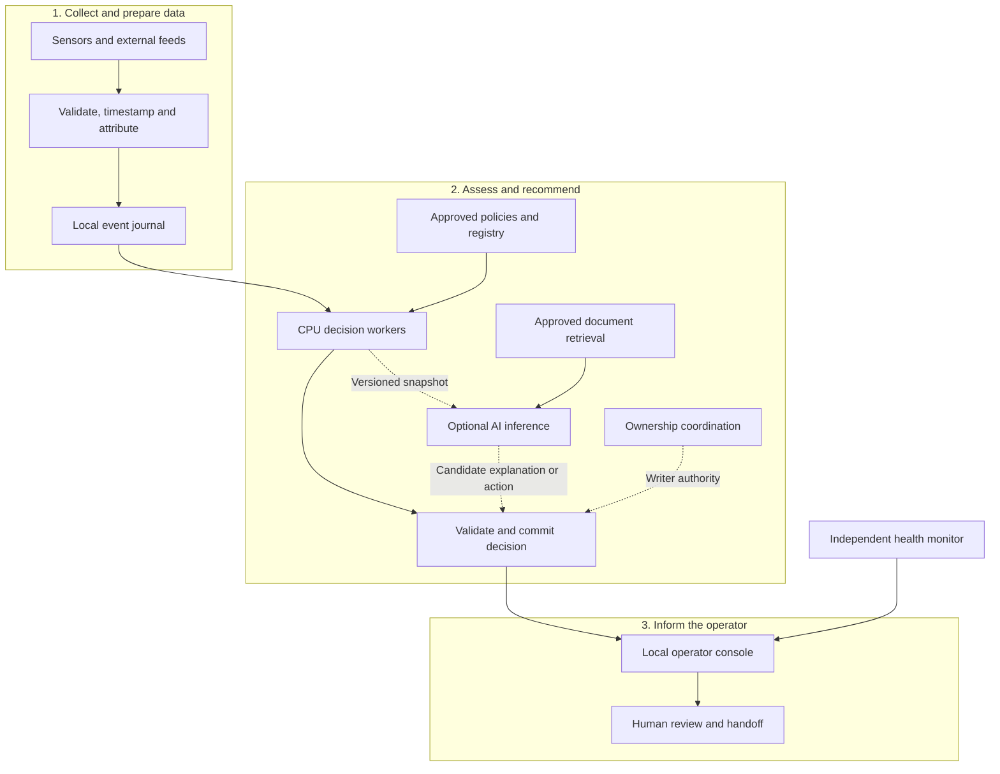

**Keep the three logical layers, but deploy them around a local decision core that continues working when AI, cloud connectivity, or individual services fail.** AI should improve interpretation and explanations; tracking, freshness checks, policy enforcement, and urgent human handoffs should have their own execution path.

The biggest architecture change is to add **explicit operating modes, controlled failover, and independent monitoring of the system itself**.

I checked the model and serving documentation, distributed-system guarantees, and joint government guidance on AI in operational technology. The design below is my recommendation; **the latency figures are proposed targets, not measured results on your hardware.**

**1. What the deployed architecture should look like**

Your existing three layers remain:



“CPU decision workers” contain your Kalman/EKF tracker, uncertainty propagation, trajectory forecasts, temporal rules, authorization checks, and incident state machine.

The optional AI service receives a **bounded snapshot** of the situation. It can suggest interpretations, verification steps, and explanations. Every proposal returns through the same deterministic validation gate.

For this hackathon, outputs remain **recommendations and human handoffs**. Physical stopping or interception remains outside the project.

This separation is consistent with the joint CISA/NSA/FBI guidance, which recommends graceful AI failure, human oversight, segmentation, and explicit procedures for bypassing unavailable AI. [fbi.gov](https://www.fbi.gov/file-repository/cyber-alerts/principles-for-the-secure-integration-of-artificial-intelligence-in-operational-technology.pdf?utm_source=chatgpt.com)

**2. Where to run each component**

Distribute components according to their deadlines and failure consequences.

| Component | Recommended location | Why |
|---|---|---|
| Sensor adapters and basic validation | Near the sensors or harbor network | Preserve observations during connectivity loss |
| Tracking, forecasts, rules, incident state | Local CPU host | Keep essential assessments independent of GPU and internet availability |
| Approved registry, zones, policy snapshot | Local storage | Continue checking known permissions and constraints offline |
| Small language model and retrieval | Separate local GPU host, if available | Isolate expensive inference from the operational core |
| Deeper reasoning and retrospective analysis | Optional cloud service | Useful when connectivity and time permit |
| Operator console | Served locally | The interface must remain accessible during an internet outage |
| Backup decision worker | Separate physical host for a real deployment | Recover from loss of the primary machine |
| Monitoring and audit collection | Locally available, with asynchronous remote copies | Detect failures and preserve evidence |

There are three practical deployment options:

| Option | Suitable use | Main trade-off |
|---|---|---|
| **One local machine, separate processes** | Weekend prototype | Handles process failures; the machine remains a single failure point |
| **Local core + separate AI service** | **Recommended hackathon architecture** | Demonstrates distributed operation and useful behavior when AI disconnects |
| **Replicated local core + local AI + optional cloud** | Harbor pilot | Better resilience, with substantially more coordination and operational work |

For your team, start with the second option. Add a standby only after the basic decision path and failure behavior are working.

For small models, distribute **independent model replicas** when capacity requires it. Splitting one model across several machines introduces communication dependencies. vLLM’s guidance recommends a single GPU when the model fits; multi-GPU and multi-node inference become relevant when memory or capacity requires them. [vLLM](https://docs.vllm.ai/en/latest/serving/parallelism_scaling/?utm_source=chatgpt.com)

**3. Use three computation paths with different budgets**

Your ensemble becomes more practical when each component has a clear execution budget.

| Path | Work performed | Trigger | Failure behavior |
|---|---|---|---|
| **Immediate assessment** | Tracking, freshness, route deviation, proximity, authorization, action constraints | Every accepted observation and relevant timer | Local fallback and visible health state |
| **Fast AI assistance** | Interpret an operator note, summarize evidence, suggest a verification step | Material change in an incident | Continue with deterministic explanation |
| **Deeper analysis** | Compare ambiguous hypotheses, review several procedures, analyze incident history | Explicit request or selected complex cases | Expire the job; preserve current assessment |

The immediate path should have **bounded work**: limited forecast horizon, bounded trajectory samples, and predictable rule evaluation. Avoid letting the number of historical observations or documents grow its execution time indefinitely.

For the AI path, retain the candidates we discussed:

- **IBM Granite 4.2 3B:** supports non-thinking, low-effort, and full-thinking modes. Start by evaluating non-thinking mode for short, structured outputs. [Hugging Face](https://huggingface.co/ibm-granite/granite-4.2-3b?utm_source=chatgpt.com)
- **Qwen3.5 4B:** supports a non-thinking configuration through its chat template. Evaluate it as an alternative using the same incident dataset. [Hugging Face](https://huggingface.co/Qwen/Qwen3.5-4B?utm_source=chatgpt.com)

Here, “System 1” means a short, bounded inference configuration. It does **not** establish a response-time guarantee or prove correctness.

One model can serve different modes initially. Running several LLMs on every observation would multiply compute demand and can still produce correlated mistakes.

**4. Optimize inference in this order**

The first gains should come from controlling **when inference happens and how much work it receives**.

| Optimization | How to apply it | Important limit |
|---|---|---|
| **Event-triggered inference** | Run AI when risk, evidence, permission, or operator context materially changes | Critical numerical checks still process relevant observations |
| **Compact structured context** | Send current state, uncertainty, reasons, and a few relevant passages | Preserve timestamps, provenance, and conflicting evidence |
| **Short structured output** | Request action ID, evidence IDs, uncertainties, and brief explanation | Valid JSON can still contain incorrect claims |
| **Warm model process** | Load the model and warm expected request shapes before use | Cold starts need separate measurement |
| **Quantization** | Compare supported 8-bit and 4-bit configurations against a higher-precision baseline | Smaller memory use does not guarantee lower latency or acceptable quality |
| **Prefix caching** | Reuse stable instructions and approved policy prefixes | Version and permission changes must invalidate the relevant cache |
| **Bounded concurrency** | Limit simultaneous jobs and reject or expire excess enrichment work | Throughput optimization can worsen tail latency |
| **Separate long jobs** | Give retrospective analysis a separate worker or constrained capacity | A shared GPU can still create resource contention |
| **Speculative decoding** | Test after the baseline is stable | Benefits depend on model, workload, and hardware |

**Quantization, concretely.** For a nominal four-billion-parameter model, ideal weight storage is approximately:

| Weight precision | Weight storage alone |
|---|---:|
| 16-bit | 8 GB |
| 8-bit | 4 GB |
| 4-bit | 2 GB |

Actual memory also includes runtime buffers, quantization metadata, activations, and attention or recurrent state. These numbers are **not hardware-sizing guarantees**.

Choose the quantization format together with the hardware and inference engine. vLLM documents substantial differences in hardware support across formats. For CPU or Apple Silicon deployment, `llama.cpp` is another option with multiple quantization formats; verify support for the exact model and pinned build. [vLLM](https://docs.vllm.ai/en/stable/features/quantization/?utm_source=chatgpt.com)

Before accepting a quantized model, test preservation of:

- Vehicle and mission identifiers.
- Negations such as “permission has **not** been confirmed.”
- Distinctions between observed facts and forecasts.
- Evidence references and uncertainty.
- Action prerequisites.

**Prefix caching** saves processing of shared prompt prefixes; it does not accelerate generation of new answer tokens. Keep stable policy context first and changing incident data afterward. Never reuse an old action merely because the new situation looks semantically similar. [vLLM](https://docs.vllm.ai/en/latest/features/automatic_prefix_caching/?utm_source=chatgpt.com)

**Speculative decoding** is an optional later experiment. vLLM describes benefits particularly for memory-bound workloads at medium-to-low request rates, with gains dependent on the configuration. Measure it against your actual short incident responses before keeping it. [vLLM](https://docs.vllm.ai/en/latest/features/speculative_decoding/?utm_source=chatgpt.com)

**5. Make distributed failover correct**

The difficult case is a machine that becomes unreachable while continuing to run.

Suppose the primary loses contact with the standby. The standby takes over, but the primary still publishes recommendations. Now the operator could receive conflicting incident states.

For automatic failover, use the following design:

1. **One authoritative writer per harbor or incident partition.**
2. A coordinator grants ownership for a limited period.
3. Each ownership change produces a monotonically increasing **fencing token**.
4. The decision commit service rejects writes from an older owner.
5. A standby becomes authoritative only after checking its state, event position, and policy versions.

A fencing token is effectively an ownership generation number. A recovered process holding generation 41 cannot overwrite decisions from generation 42.

etcd provides leases, revisions, and conditional transactions that can support this design. Your application must enforce ownership when committing decisions; merely obtaining a distributed lock is insufficient. [etcd](https://etcd.io/docs/v3.6/learning/api/?utm_source=chatgpt.com)

For a pilot, a three-member local coordination cluster can retain a majority after one member fails. If the majority is unavailable, authoritative writes stop. etcd explicitly documents this behavior during majority loss and network partitions. [etcd](https://etcd.io/docs/v3.6/op-guide/failures/?utm_source=chatgpt.com)

Your application should then:

- Continue showing available local observations.
- Display **“coordination unavailable—local advisory mode.”**
- Prevent competing authoritative incident transitions.
- Direct the operator to the approved manual procedure.

Keep this quorum on reliable local infrastructure. Cloud connectivity should not be required to retain local operating authority.

Also, three containers on one laptop share the laptop’s failure. Real resilience needs separate machines and consideration of shared power, switches, storage, and sensor gateways.

**6. Preserve events without duplicating decisions**

A useful event record should contain:

```text
event_id
source_id + source_sequence + source_boot_id
observed_at + received_at
coordinate_frame + units
measurement + uncertainty
schema_version
```

A decision record should contain:

```text
decision_id + incident_id
input_event_position + relevant_state_revision
policy_version + registry_version
model_version, when applicable
operating_mode + evidence_ids
owner_generation + expiry
```

These fields support replay, diagnosis, and rejection of outdated results.

For example, an AI job starts while an unknown vehicle is approaching a zone. While it runs, the operator verifies the mission. When the job returns, the engine rechecks its assumptions against the current state before displaying its proposed action.

For transport, **NATS JetStream is a reasonable candidate** for the prototype’s replayable event stream. Treat delivery as potentially duplicated:

- Deduplicate using event identifiers.
- Persist state changes and processing position coherently.
- Assign stable identifiers to decisions and handoffs.
- Make retries idempotent—repeating a request produces the same logical effect.
- Keep historical replay visibly separate from live observations.

JetStream documents at-least-once delivery and bounded deduplication mechanisms. Those features do not automatically make application state updates or external notifications exactly once. [GitHub](https://github.com/nats-io/nats.docs/blob/master/nats-concepts/jetstream/README.md?utm_source=chatgpt.com)

**Durability needs deliberate configuration.** NATS documents the performance trade-off of synchronizing each message to disk before acknowledgment. Primary fault-injection research on NATS 2.12.1 also found data-loss and divergence cases under particular storage and OS failures. For a deployment, review the selected release, configure durability intentionally, and test crash recovery; a replication setting alone is insufficient evidence. [GitHub](https://github.com/nats-io/nats.docs/blob/master/nats-concepts/jetstream/README.md?utm_source=chatgpt.com)

For the weekend, a single durable journal and explicit recovery demonstration are a sensible starting point.

**7. Define fallback behavior by capability**

A fallback should say which functions remain trustworthy.

| Failure | What continues | What changes |
|---|---|---|
| Internet unavailable | Local observations, tracking, policy checks, console | Cloud analysis pauses |
| Cloud AI unavailable | Local AI, if provisioned; numerical assessment | Explain reduced analysis capability |
| All AI unavailable | Tracking, rules, forecasts, structured evidence, template explanations | AI interpretations disappear |
| Retrieval unavailable | Structured policy checks and approved local procedures | No generated claims requiring unavailable documents |
| One sensor unavailable | Assessment using remaining evidence | Show reduced coverage and adjusted uncertainty |
| All useful sensors unavailable | Incident history and last-known observations | Show **“current assessment unavailable”** |
| Coordination quorum unavailable | Local observation and advisory display | Authoritative incident transitions pause |
| Primary machine fails | Standby recovery, if deployed and validated | Show interruption and recovery status |
| Site-wide power loss | Only independently powered equipment remains available | Invoke manual continuity arrangements |

Avoid treating these as one linear “healthy/degraded” flag. The system may have working AI but poor sensor coverage, or excellent observations but no coordination authority.

Expose separate statuses for:

**data freshness · coverage · decision processing · AI · coordination · operator acknowledgment**

For missing observations, prediction uncertainty should increase only within the model’s validated horizon. Eventually, the correct output is “insufficient current evidence.” Continuing to draw a precise moving marker would conceal the loss of observation.

**8. Prevent overload from becoming a cascade**

A crisis may generate many more tracks, repeated reports, and simultaneous operator queries.

Use separate queues:

| Priority | Examples | Overload behavior |
|---|---|---|
| Highest | Fresh observations, coverage-loss events, critical state transitions | Reserve capacity; explicitly report any processing loss |
| Medium | AI incident enrichment | Coalesce superseded jobs per incident |
| Lowest | Reports, historical analysis, bulk indexing | Pause or reject until capacity returns |

Coalesce **AI work**, carefully. Dropping intermediate physical observations can hide a brief zone crossing or corrupt tracking.

Every remote operation needs:

- A deadline.
- Bounded retries with jitter.
- A shared retry budget.
- A circuit breaker.
- Cancellation of work that is no longer useful.

gRPC has no deadline by default; its documentation also notes that applications must stop spawned work after cancellation. Envoy documents request, connection, and retry limits intended to contain overload. [gRPC](https://grpc.io/docs/guides/deadlines/?utm_source=chatgpt.com)

Reserve CPU and memory for the decision core. Run model inference separately with resource limits. Automatically starting a CPU LLM after GPU failure could otherwise starve the very service that must continue.

Health checks need distinct meanings:

- **Startup:** initialization and recovery have completed.
- **Readiness:** this instance can accept its assigned work.
- **Liveness:** the process is making progress and requires restart if irrecoverably stuck.

A cloud outage should change capability status, not trigger repeated restarts of a healthy local core. Kubernetes explicitly warns that poorly designed liveness probes can cause cascading failures. [Kubernetes](https://kubernetes.io/docs/concepts/workloads/pods/probes/?utm_source=chatgpt.com)

**9. Security should follow the actual attack paths**

My proposed controls are:

| Attack or mistake | Control | Remaining limitation |
|---|---|---|
| Fake publisher submits telemetry | Per-source credentials, mutual TLS where supported, publish permissions, schema checks | An authenticated compromised source can still lie |
| Old observations are replayed | Event IDs, sequence numbers, boot identifiers, freshness checks | Delayed legitimate data needs explicit handling |
| Operator note contains prompt injection | Treat text as untrusted evidence; restrict AI to read-only tools and bounded outputs | Prompts alone cannot enforce access control |
| Retrieved document changes permissions | Permission checks use approved structured records; document versions and authority are verified | Approved source material can itself contain errors |
| Model invents an action | Fixed action catalog, prerequisite checks, evidence validation | Validated actions still depend on correct policy design |
| AI server is compromised | Network separation, minimum credentials, restricted egress, no direct policy writes | Shared hosts and credentials can undermine isolation |
| Unauthorized user changes policy | Role-based access, strong authentication, reviewed versioned updates, audit history | Emergency access requires a defined local procedure |
| Bad model or software update | Pinned versions, artifact verification, staged rollout, rollback | Every new combination still needs validation |

Two distinctions matter:

**Transport authentication does not establish physical truth.** A secure connection to an AIS receiver authenticates that connection; it does not prove the identity claimed by every radio message.

**Human approval needs fresh context.** Before recording approval, revalidate the incident revision and show what changed since the recommendation was generated.

For vLLM specifically, its security documentation warns that internal distributed communication ports need protection and that the API-key setting does not protect every endpoint. Put inference behind a restricted gateway, allow only required routes, and keep administrative/internal ports private. Disable unnecessary media fetching and tool execution. [vLLM](https://docs.vllm.ai/en/latest/usage/security/?utm_source=chatgpt.com)

Also prepare offline operation deliberately: locally available authentication, policy validity periods, certificate-expiry monitoring, and audited emergency procedures. Losing internet connectivity should never require disabling authentication.

**10. How fast can it respond?**

Measure several different delays:

\[
T_{\text{observation-to-display}}
=
T_{\text{sensor/transport}}
+
T_{\text{queue}}
+
T_{\text{assessment}}
+
T_{\text{delivery}}
\]

Human acknowledgment adds another interval.

A fast inference server cannot compensate for an observation that arrives late. Underwater reporting schedules and acoustic communication must be reflected in your freshness rules.

For an initial benchmark, define an explicit workload—for example, **50 simulated tracks producing two observations per second**, followed by a tenfold burst.

Suggested initial targets:

| Measurement | Proposed target or budget |
|---|---|
| Numerical assessment after event admission | p95 under 50 ms; p99 under 100 ms |
| Accepted event to local console update | p95 under 250 ms; p99 under 500 ms |
| Fast AI enrichment | Initial 3-second deadline; expire late work |
| Deeper optional analysis | Initial 10-second deadline; never delay immediate assessment |
| Standby recovery | Initial target within 5 seconds, including freshness and ownership checks |

These are **engineering targets to test and revise**. They are neither measured performance nor certified real-time guarantees.

For perspective, generating 150 output tokens at 50 tokens/second already takes about three seconds, before queueing and prompt processing. Short outputs therefore matter.

Measure:

- p50, p95, and p99 decision latency.
- Queue age and dropped or expired work.
- AI time to first token **and complete validated response**.
- GPU memory and inference concurrency.
- Cold-start and recovery time.
- Sensor freshness and coverage.
- Duplicate decisions and rejected stale-owner writes.
- Time until a human acknowledges the handoff.

vLLM exposes inference latency and serving metrics that can support this instrumentation. [vLLM](https://docs.vllm.ai/en/latest/design/metrics/?utm_source=chatgpt.com)

**11. Extreme scenarios the judges can challenge**

Build a fault-injection panel into the simulator. It makes resilience visible and testable.

| Scenario | Expected behavior | Evidence to show |
|---|---|---|
| Disconnect the internet | Local assessments and console continue | Cloud status changes; local decision latency remains measured |
| Kill the model process | Template explanations replace AI output | New observations still produce assessments |
| Exhaust GPU memory | Inference fails in isolation | Decision worker remains alive and responsive |
| Flood the system with events | Optional work sheds first; any coverage loss is explicit | Queue age, expired jobs, and processing metrics |
| Crash the primary worker | Validated standby takes ownership | Recovery time and one authoritative writer |
| Partition primary and standby | Stale owner cannot commit | Rejected fencing token and visible advisory mode |
| Replay old telemetry | Old data cannot masquerade as fresh | Rejection or historical classification |
| Introduce a clock jump | Local deadlines remain stable; timestamp uncertainty is flagged | Correct timeout and freshness behavior |
| Return AI output after mission approval changes | Proposal is revalidated or discarded | No obsolete action reaches the operator |
| Insert “ignore policy” into a note | Text remains evidence with no authority | Policy and action constraints remain enforced |
| Make sensors disagree | Preserve disagreement and uncertainty | No unjustified confident identification |
| Remove all observations | Current coverage becomes unavailable | No “all clear” based on silence |
| Fill the disk | Storage degradation is detected and surfaced | Explicit durability status and bounded buffering |
| Restore services with a large backlog | Historical replay is separated from live assessment | No duplicate handoff storm |
| Operator never acknowledges | Incident stays unacknowledged; approved escalation procedure applies | Handoff is never falsely marked complete |

The entire site losing power or every sensor failing remains a physical limitation. Redundant power, diverse sensing, alternate communication, and trained people address those cases. Software should make the limitation apparent.

**12. What your three-person team should actually build**

| Owner | Deliverable |
|---|---|
| **You: decision engine** | CPU assessment path, action validator, versioned AI requests, timeouts, fallback explanations, operating modes, latency instrumentation |
| **Data/simulator teammate** | Timestamped event stream, duplicate/replay handling, sensor dropout, conflicting measurements, bursts, clock anomalies |
| **UI/integration teammate** | Local console, separate capability indicators, evidence timeline, acknowledgment workflow, service supervision, failure controls |

Implement in this order:

1. **Run the complete local assessment loop.** Accept an observation, update the track, evaluate rules, produce a traceable recommendation.
2. **Add AI asynchronously.** The initial assessment should already be visible while enrichment runs.
3. **Add deadlines and stale-result rejection.** Demonstrate that a late answer cannot overwrite newer facts.
4. **Separate the AI service onto another process or machine.** Kill and disconnect it during the demo.
5. **Add replay and deduplication.** Restart the core and recover incident history without duplicate handoffs.
6. **Add standby ownership only if you can test it properly.** Otherwise, present automatic failover as the pilot extension.
7. **Compare model configurations.** Use the same held-out scenarios for higher precision versus quantized, thinking versus non-thinking, and caching on versus off.
8. **Record a fault-test scorecard.** Report measured latency, recovery behavior, lost capabilities, and unresolved limitations.

For the weekend, I would prioritize **a reliable CPU core, one small AI service, a local console, and six convincing failure demonstrations**. Those give you concrete evidence that the architecture remains useful under stress—and a clear foundation for the more demanding harbor pilot.