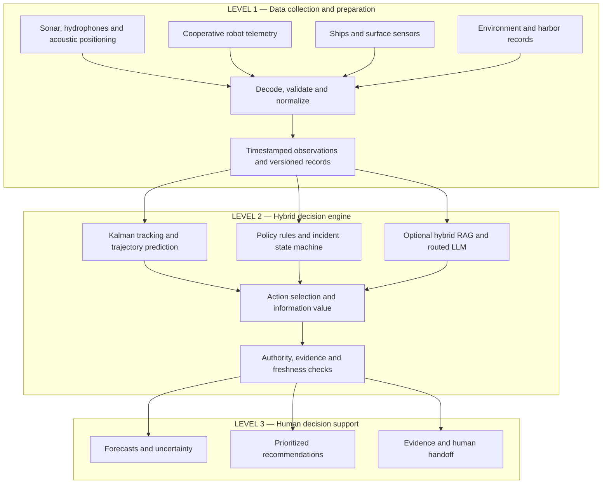

**Your architecture should have three levels: collect and structure evidence → estimate, predict, and decide → present forecasts and recommended actions to a human.**

Below is the proposed target architecture. **For the hackathon, we should simulate the sensor observations and connect real data sources only where access is already available.** The hardware sources are integration options, not equipment you need to build this weekend.

**Level 1: Where the data comes from**

A ship, buoy, or dock is usually the **platform carrying a sensor or communication gateway**. The meaningful input comes from the instruments, vehicle messages, and operational records.

| Source | Where we would obtain it | Meaningful data it provides | Important distinction |
|---|---|---|---|
| **Underwater sonar** | Existing harbor installation, ship-mounted equipment, or a monitoring platform | Detected contacts, range/bearing where available, timestamps, detection quality | A detection does not establish identity or authorization |
| **Hydrophones** | Underwater microphones on buoys, seabed stations, or ships | Acoustic recordings and detected sound events | Sound alone does not automatically give an accurate location or vehicle identity |
| **Acoustic positioning: USBL/LBL** | Support vessel or installed positioning network | Position estimates for compatible underwater transponders | Useful for cooperative equipped robots; cannot assume every unknown vehicle responds |
| **Cooperative AUV/ROV telemetry** | Robot operator’s gateway, acoustic modem, or tether | Reported position, depth, battery, navigation status, mission progress | Available only when the vehicle shares it |
| **AIS from surface vessels** | Local AIS receiver or an available data provider | Reported vessel identity, position, course, speed, navigation status | Provides surface traffic context; it is not underwater detection |
| **Surface radar and cameras** | Harbor control or participating vessels | Surface contacts and visual observations | Useful for nearby ships, support boats, and surfaced objects |
| **Environmental observations** | Local instruments or NOAA services | Currents, water levels, wind, and other available conditions | Station location, depth, age, and coverage matter |
| **Harbor records and human reports** | Mission registry, operator portal, approved documents, officer input | Approved missions, restricted areas, expected contact schedules, procedures, attributed observations | Authoritative records and unverified reports must remain distinguishable |

The source distinctions matter: Sonardyne describes USBL positioning as measuring range and bearing to an acoustic transponder; NOAA describes hydrophones as recording underwater sound; USCG documents AIS position and voyage reports. These are different evidence types. [sonardyne.com](https://www.sonardyne.com/wp-content/uploads/2021/06/Sonardyne_Ranger_2_USBL-1.pdf?utm_source=chatgpt.com)

NOAA’s CO-OPS API exposes observations and predictions such as water levels, currents, and meteorological data where available. We would use these as environmental context, with their original timestamps and station metadata. [api.tidesandcurrents.noaa.gov](https://api.tidesandcurrents.noaa.gov/api/prod/?utm_source=chatgpt.com)

**How we turn those inputs into usable evidence**

There are two entry points:

- **Already processed observations:** A sonar system or robot gateway supplies detections or position estimates. Our adapter validates and normalizes them.
- **Raw recordings:** Audio or imagery first needs a dedicated detection pipeline. For the weekend, use simulated or recorded detection outputs rather than building underwater perception from scratch.

The preparation pipeline should perform these operations:

| Processing step | What happens |
|---|---|
| **Decode** | Convert each provider’s messages into typed records |
| **Validate** | Check required fields, units, timestamps, missing values, and plausible ranges |
| **Normalize coordinates** | Convert compatible positions into a common harbor reference frame; retain the original frame |
| **Preserve measurement limits** | Keep a bearing-only observation as bearing-only; do not invent a full position |
| **Handle timing** | Store observation time and arrival time separately; identify duplicates and late messages |
| **Attach provenance** | Record source ID, sensor type, measurement uncertainty, and whether the value is measured, reported, or derived |
| **Store appropriately** | Keep live observations, exact mission records, and searchable documents in separate logical stores |

For example:

> A support vessel reports a cooperative robot’s estimated position, depth, timestamp, and uncertainty. Its adapter converts the coordinates into the harbor frame and stores the observation with the source reference. The tracking model then updates the robot’s estimated state.

The output of Level 1 is a **structured evidence package**, not an AI-generated narrative:

| Record | Essential contents |
|---|---|
| **Observation** | Observation ID, source, measurement type/value, units, coordinate frame, observed time, received time, uncertainty |
| **Mission** | Vehicle ID, verified association, permitted area, validity period, expected communication schedule |
| **Zone** | Geometry, applicable depth if known, restriction type, effective time, version |
| **Environment** | Measurement or forecast, location/depth, timestamp, uncertainty |
| **Report/document** | Author/source, text, applicability, version, verification status |

An unknown contact can have a `track_id` while its `vehicle_id` remains unknown.

**Level 2: The models and algorithms working together**

I would use the following concrete construction. The first version needs **one language model**, while the numerical and policy components provide the other kinds of intelligence.

| Component | Model or algorithm | Input | Output |
|---|---|---|---|
| **Track estimation** | **Kalman Filter**; use an **Extended Kalman Filter** when the measurement model requires it | Accepted observations, previous track state, sensor uncertainty | Estimated position, velocity, covariance |
| **Trajectory prediction** | **Constant-velocity motion model + sampled trajectory rollouts** | Estimated track and motion uncertainty | Possible future paths, zone overlap, conditional time-to-boundary |
| **Behavior assessment** | **Temporal rules**; optional **Isolation Forest** | Route deviation, speed changes, contact timing, mission context | Specific deviations and optional anomaly score |
| **Authorization assessment** | **Typed policy rules** | Verified identity association, mission, zone, time | Authorized, unknown, or outside approved scope |
| **Incident management** | **Finite-state machine** | Current findings, previous incident state, operator responses | Watching, verifying, handoff pending, human owned |
| **Document retrieval** | **BM25 + BGE-small-en-v1.5 embeddings + Reciprocal Rank Fusion** | Context query and applicable approved documents | Ranked evidence passages with references |
| **Semantic analysis** | **IBM Granite 4.2 3B**; alternative **Qwen3.5 4B** | Compact state summary, retrieved evidence, attributed reports | Structured interpretations, missing information, candidate action IDs |
| **Action planning** | **Constrained action enumeration + one-step value-of-information estimate** | Risk findings, allowed actions, evidence gaps, response time | Recommended action and useful next information request |
| **Final verification** | **Schema, policy, prerequisite, citation, and freshness checks** | Candidate recommendation and current state | Accepted recommendation or a reason for rejection |

Stone Soup provides a concrete Kalman tracking implementation with prediction, measurement updates, and uncertainty. BGE-small is an available embedding model, and hybrid retrieval systems can combine dense and sparse rankings through reciprocal rank fusion. [stonesoup.readthedocs.io](https://stonesoup.readthedocs.io/en/latest/auto_tutorials/01_KalmanFilterTutorial.html?utm_source=chatgpt.com)

Granite 4.2 3B supports non-thinking, low-effort, and full-thinking modes. Qwen3.5 4B also supports thinking and non-thinking operation. We should benchmark them on our cases before choosing; neither is automatically a validated maritime decision model. [huggingface.co](https://huggingface.co/ibm-granite/granite-4.2-3b?utm_source=chatgpt.com)

**How the components cooperate**

1. **The tracker updates what we know about movement.**  
   It estimates location and velocity while preserving uncertainty.

2. **The predictor looks ahead.**  
   It estimates whether plausible future paths intersect a restricted area. Forecasts remain conditional on the motion assumptions.

3. **The policy engine checks authorization independently.**  
   It determines whether the mission covers the current area and time. A plausible trajectory does not prove vehicle identity.

4. **The incident manager interprets the change over time.**  
   It prevents duplicate alerts, tracks pending verification, and notices when a response is overdue.

5. **The AI branch runs only when context requires it.**  
   It retrieves a relevant procedure, interprets an operator note, or explains conflicting information. Live positions come directly from the state store.

6. **The planner compares available responses.**  
   It selects among watching, checking records, requesting evidence, and handing off. It considers whether gathering more information could change the decision before the response window closes.

7. **The verifier checks the recommendation against the latest state.**  
   It rejects stale proposals, unsupported authorization claims, and unavailable or unauthorized actions.

**The numerical and policy path continues while the AI branch runs.** A handoff that is already required should not wait for a generated explanation.

For the language model, begin with two roles:

- **Fast mode:** Extract information from notes and produce short grounded explanations.
- **Deliberative mode:** Compare a few allowed alternatives when the evidence is ambiguous and time permits.

The same checkpoint can perform both roles with different inference settings.

**Level 3: What the human receives**

The officer should receive several distinct outputs rather than one opaque “threat score.”

| Output | What appears in the interface |
|---|---|
| **Current situation** | Track location, estimated movement, depth if known, identity status, and last observation time |
| **Predictive view** | Future-path envelope, possible zone intersections, and forecast horizon |
| **Authorization view** | Which mission or restriction applies, including unresolved associations |
| **Behavior insights** | Route deviation, missed scheduled contact, unusual movement, or conflicting observations |
| **Evidence quality** | Stale data, uncertain position, missing records, and disagreement between sources |
| **Recommended next action** | Watch, check mission, request fresh evidence, verify with an operator, or hand off |
| **Reason and alternatives** | Supporting evidence, why this action was selected, and what would change it |
| **Human handoff package** | Incident timeline, map, evidence references, outstanding questions, and acknowledgment status |

A course-of-action card should contain:

| Field | Example |
|---|---|
| **Recommendation** | Request officer review |
| **Reason** | Predicted movement intersects the restricted dock area; mission association remains unresolved |
| **Supporting evidence** | Recent track observations and current zone definition |
| **Uncertainty** | Position estimate has widened; identity is unverified |
| **Useful next evidence** | Fresh position observation |
| **Reassessment trigger** | New observation, verified mission match, or response deadline |
| **Human status** | Handoff pending acknowledgment |

**An illustrative end-to-end example**

Suppose a simulated underwater contact moves toward a restricted dock while a research operator reports that one robot is off course.

- **Input processing:** The contact observations and operator report enter as separate, timestamped evidence.
- **Tracking:** The Kalman filter estimates movement and its uncertainty.
- **Prediction:** Some plausible paths enter the restricted region.
- **Policy:** The engine finds a nearby research mission, but cannot yet establish that the contact is that robot.
- **AI and retrieval:** The model retrieves the applicable lost-contact procedure and identifies what information would help verify the association.
- **Action planning:** If time permits, it recommends a targeted verification. If waiting would consume the available response window, it recommends a handoff immediately.
- **Human output:** The officer sees the projected paths, unresolved identity, relevant evidence, and the next action.

The operator’s report provides a hypothesis; it does not automatically relabel the track.

**For this weekend, implement this specific subset**

| Level | Build now | Keep as an integration option |
|---|---|---|
| **Inputs** | Simulated underwater detections, cooperative robot telemetry, mission registry, restricted zones, operator notes | Real sonar, hydrophones, USBL, AIS, cameras |
| **Processing** | Timestamp validation, coordinate normalization, uncertainty fields, event replay | Raw acoustic/image detection pipelines |
| **Engine** | Kalman tracking, trajectory forecasts, policy rules, incident state machine, hybrid retrieval, one LLM, action verification | Learned anomaly detector, advanced track association, full POMDP planner |
| **Human outputs** | Map, forecast envelope, evidence panel, recommendation, acknowledgment | Operational communications integrations |

**Your decision-engine boundary is clear: it receives structured observations and records, then returns a versioned decision package containing estimates, predictions, evidence, uncertainty, and recommended actions.** This lets your teammates build the simulator and dashboard independently against a stable interface.